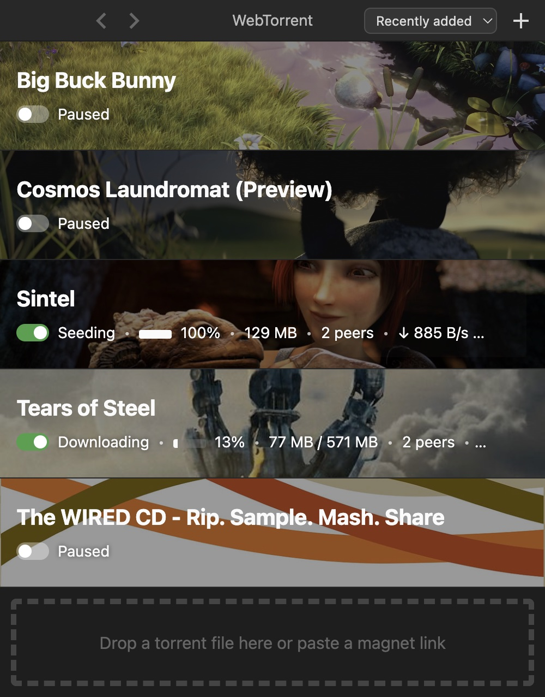
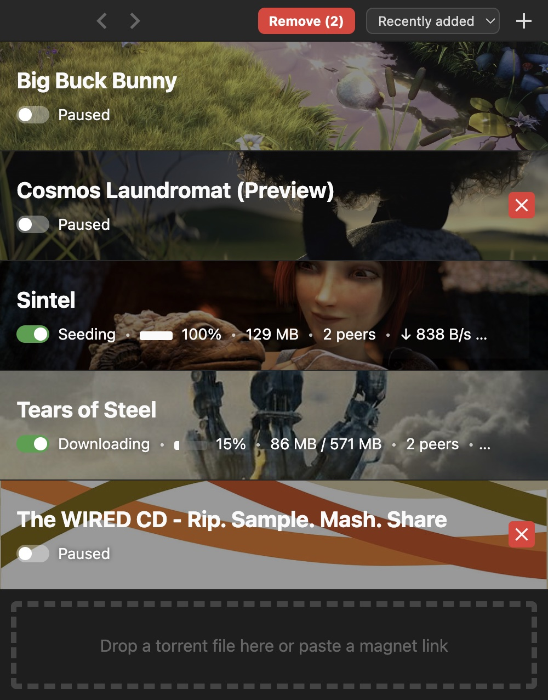

<h1 align="center">
  <br>
  <a href="https://webtorrent.io">
    
  </a>
  <br>
  WebTorrent Desktop
  <br>
  <br>
</h1>

<h4 align="center">The streaming torrent app. For Mac, Windows, and Linux.</h4>

An unofficial, maintained fork of
[WebTorrent Desktop](https://github.com/webtorrent/webtorrent-desktop), which has had only
automated dependency updates since August 2024. This fork updates the app to Electron 44,
WebTorrent 3, and React 19, with:

- Native builds for Apple Silicon Macs (M1 and later). Intel Macs aren't supported.
- Faster startup and resume of unfinished downloads.
- A start/pause switch and checkboxes for removing multiple torrents.
- IINA support on macOS, alongside VLC and other external players.
- No telemetry, crash reports or announcements. One update check at startup, which you can turn off (see [Privacy](#privacy)).

<p align="center">
  <a href="https://github.com/tommyent/webtorrent-desktop/actions/workflows/ci.yml"></a>
  <a href="https://standardjs.com"></a>
</p>

## Install

Download a build for macOS, Windows or Linux from the
[releases page](https://github.com/tommyent/webtorrent-desktop/releases). The builds are not
signed, so each release's notes explain how to open them the first time. You can also
[build it from source](#how-to-contribute) and package it for your platform (see
[Package the app](#package-the-app)).

The [upstream website](https://webtorrent.io/desktop/) and `brew install --cask webtorrent`
distribute the upstream app and do not include this fork's changes.

## Screenshots

<p align="center">
  
</p>
<p align="center">
  
  
</p>

Film images in these screenshots come from the app's built-in sample films, licensed under
[CC BY 3.0](https://creativecommons.org/licenses/by/3.0/): *Sintel*, © copyright Blender
Foundation | www.sintel.org; *Big Buck Bunny*, (c) copyright 2008, Blender Foundation /
www.bigbuckbunny.org; *Tears of Steel*, (CC) Blender Foundation | mango.blender.org;
*Cosmos Laundromat*, (CC) Blender Foundation | gooseberry.blender.org.

## How to Contribute

### Get the code

```
$ git clone https://github.com/tommyent/webtorrent-desktop.git
$ cd webtorrent-desktop
$ npm ci
```

Development requires Node.js 22.12 or newer and npm 10 or newer.

### Run the app

```
$ npm start
```

### Watch the code

Restart the app automatically every time code changes. Useful during development.

```
$ npm run watch
```

### Run linters

```
$ npm test
```

### Run tests

```
$ npm run build
$ npm run test-unit
$ CI=1 npm run test-integration
```

The unit tests cover controller and engine behavior. The integration tests use Playwright and
Tape to click through the app and compare screenshots with the checked-in baselines. `CI=1` skips
the live-video and fullscreen screenshots, which vary with graphics hardware and display settings.
CI runs the full integration suite on macOS and the audit UI test on Windows and Linux.

For intentional UI changes on macOS, regenerate the baselines and review the image diffs:

```
$ UPDATE_SCREENSHOTS=1 npm run test-integration
$ CI=1 npm run test-integration
```

Run one Electron test suite at a time; the suites share a temporary test profile.

### Package the app

Builds the app for the current platform.

```
$ npm run package
```

To choose the platform and options:

```
$ npm run package -- [platform] [options]
```

Where `[platform]` is `darwin`, `linux`, `win32`, or `all`. When omitted, the current platform is
built.

The following optional arguments are available:

- `--sign` - Sign the application (Mac, Windows)
- `--arch=[architecture]` - Override the target architecture. macOS supports only `arm64`;
  Linux supports `arm64`, `armv7l`, and `x64` (the build machine's by default);
  Windows supports only `x64`.
- `--package=[type]` - Package single output type.
   - `deb` - Debian package
   - `rpm` - RedHat package
   - `zip` - ZIP archive (Mac, Linux)
   - `dmg` - Mac disk image
   - `exe` - Windows installer
   - `portable` - Windows portable app
   - `all` - All types for the platform (default)

Note: Mac builds always produce a ZIP archive, even with `--package=dmg`.

#### Windows build notes

Package the Windows app on **Windows**, as the release builds do. Building the installer on
macOS or Linux also needs [Wine](https://www.winehq.org/) and
[Mono](https://www.mono-project.com/).

Windows code signing only works on **Windows**.

#### Mac build notes

The Mac app can only be packaged from **macOS**.

macOS packages are Apple Silicon only (M1 and later), and the build fails if a native addon in
the app has no Apple Silicon code. For a quicker local build without the DMG, run:

```
$ npm run package -- darwin --package=zip
```

#### Linux build notes

Package the Linux app on Linux, on the CPU it's for: npm installs some native addons for the
build machine only, and the build fails if an addon in the app doesn't match the target. The
release builds use x64 and arm64 runners. The Linux zip's `webtorrent-desktop` script starts the
app without Chromium's sandbox, as the `.deb`'s menu entry does, since a zip can't keep its
sandbox helper setuid root.

#### Recommended readings to start working in the app

Electron (framework for desktop apps for Windows, macOS, and Linux in JavaScript):
https://www.electronjs.org/docs/latest

React (the UI library):
https://react.dev/learn

### Privacy

This fork does not send telemetry or crash reports or fetch announcements.

When it opens, it asks GitHub's releases API once whether a newer version of
this fork exists, and shows a line in the torrent list if so. The request
carries no identifier, but GitHub sees your IP address, as any website does.
Turn it off in Preferences → General → "Check for new versions when WebTorrent
opens". Nothing is downloaded or installed for you: install updates manually.

Torrent networking (peers, trackers, DHT, and web seeds) still operates normally.

## License

MIT. Copyright (c) [WebTorrent, LLC](https://webtorrent.io).
