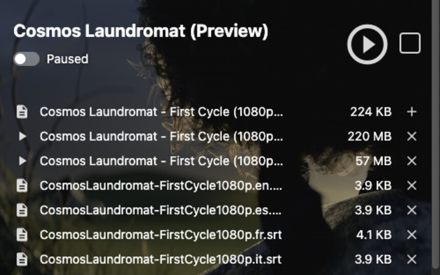
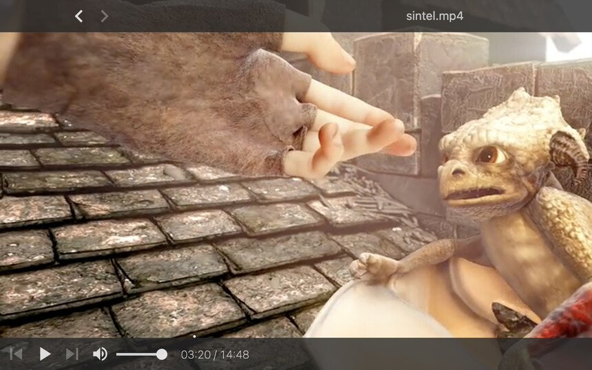
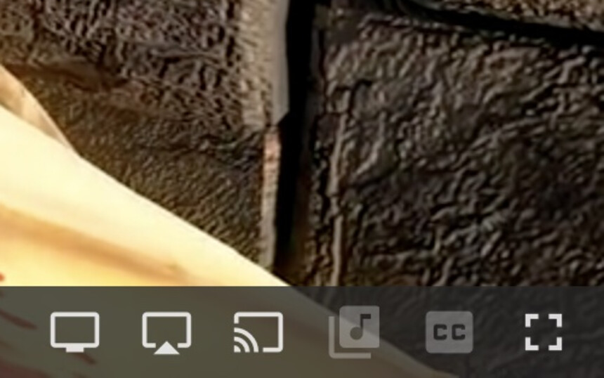
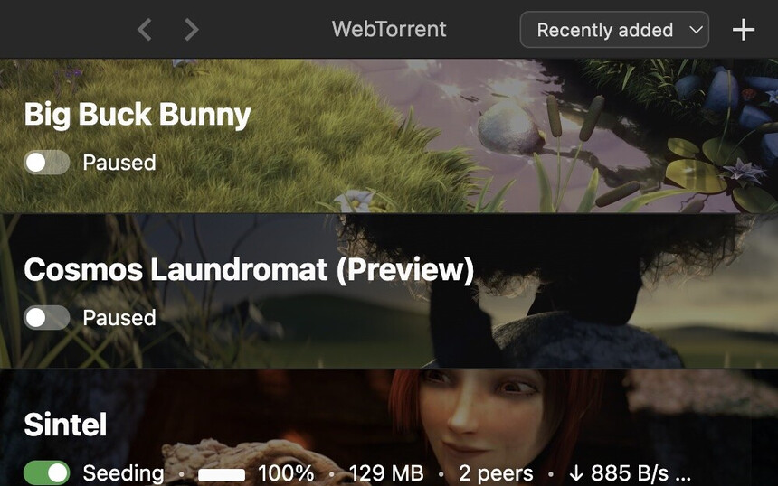
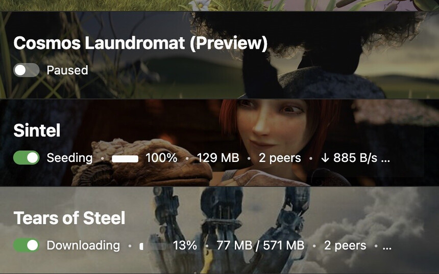
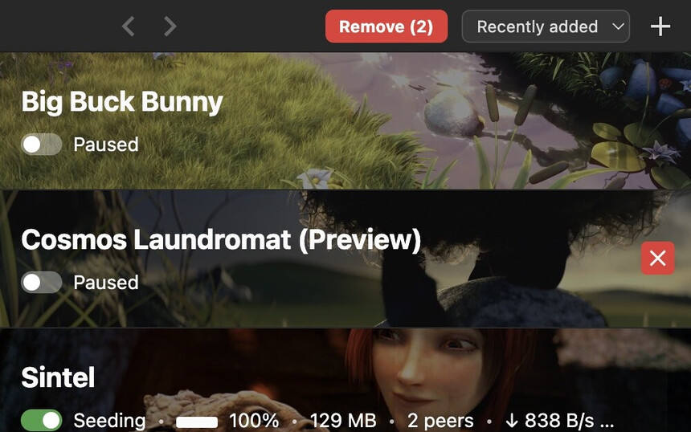

<h1 align="center">
   
  WebTorrent Desktop
</h1>

Stream video torrents while they download on macOS, Windows, and Linux.

An unofficial, maintained fork of <a href="https://github.com/webtorrent/webtorrent-desktop">WebTorrent Desktop</a>, with Apple Silicon builds and faster download resume.

  <a href="https://github.com/tommyent/webtorrent-desktop/releases/latest"><strong>Download</strong></a> ·
  <a href="docs/features.md"><strong>All features</strong></a> ·
  <a href="docs/"><strong>Docs</strong></a>

## Features

Click a picture to see it full size.

<table>
  <tr>
    <td width="33%" valign="top"> <b>Choose files</b> to download</td>
    <td width="33%" valign="top"> <b>Stream while downloading</b></td>
    <td width="33%" valign="top"> <b>Playback controls</b> for casting, subtitles and fullscreen</td>
  </tr>
  <tr>
    <td valign="top"> <b>Pause and resume</b> torrents</td>
    <td valign="top"> <b>See progress</b> and sort the list</td>
    <td valign="top"> <b>Remove several</b> torrents together</td>
  </tr>
</table>

[All features →](docs/features.md)

## Install

1. [Download a build](https://github.com/tommyent/webtorrent-desktop/releases/latest) for your platform.
2. Open the macOS DMG, run the Windows installer, or install the Linux `.deb`. Portable ZIP builds are also available.
3. The macOS and Windows builds are not publisher-signed; follow that release's first-launch steps if your system blocks them.

Tested on macOS 26.5.1 (Apple silicon), Windows 11 Pro 24H2 ARM64 (x64 build under emulation), and Ubuntu 26.04.1 LTS ARM64 (`.deb` and `.zip`).

The [upstream website](https://webtorrent.io/desktop/) and `brew install --cask webtorrent` distribute the upstream app and do not include this fork's changes.

## Docs

[Features](docs/features.md) · [Privacy](docs/privacy.md) · [Build from source](docs/building.md) · [Release process](RELEASE_PROCESS.md)

## Credits and licence

This is an unofficial fork of [WebTorrent Desktop](https://github.com/webtorrent/webtorrent-desktop) by [WebTorrent, LLC](https://webtorrent.io), not an upstream release. The code is under the [MIT License](LICENSE). [Screenshot film credits](docs/features.md#screenshot-film-credits).
