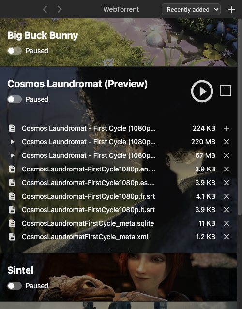
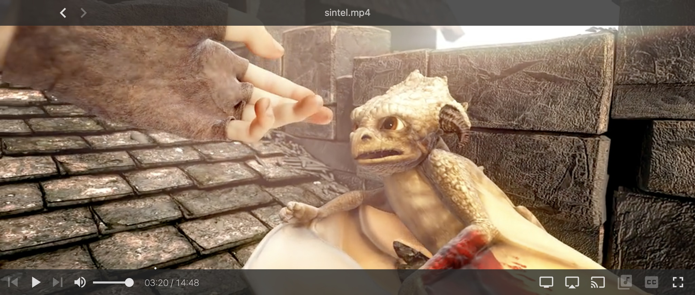
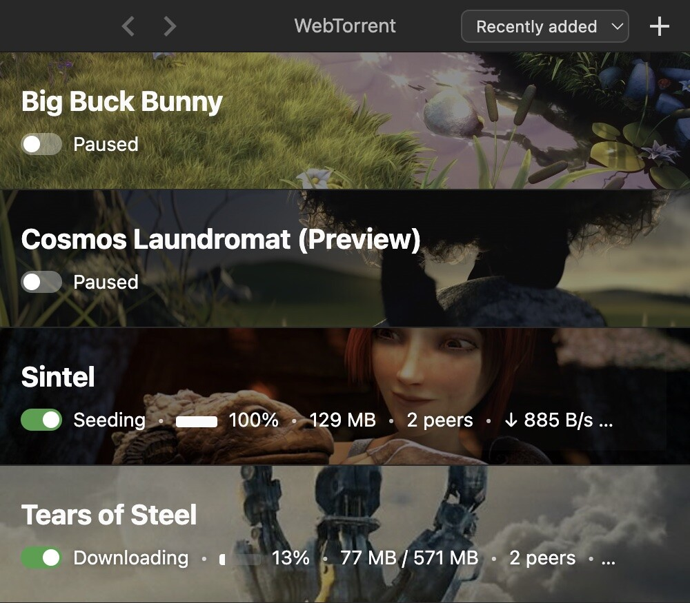
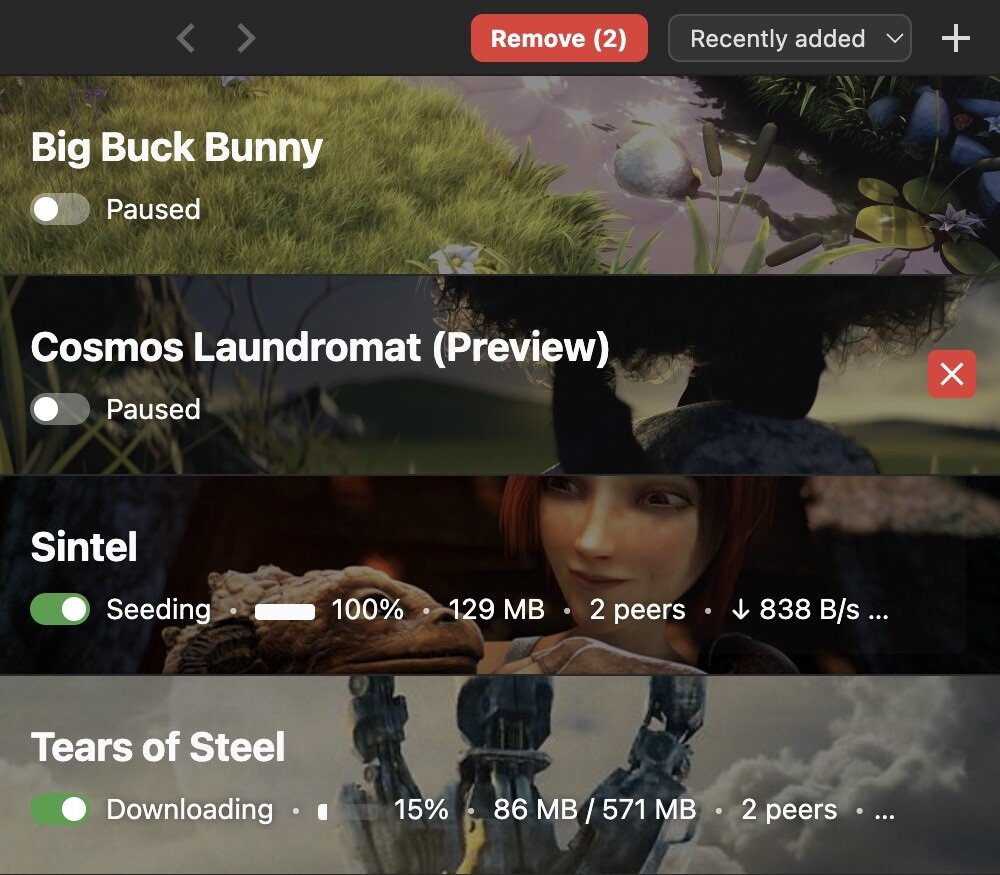

# Features

## Choose files

Open a torrent file or magnet link, then choose which files to download. The app's built-in
sample torrents let you try the player with Creative Commons films.

## Play while downloading

Stream video before the torrent finishes. The player includes playback, subtitle, fullscreen,
and casting controls. On macOS, IINA is supported alongside VLC and other external players.

## Manage downloads

Pause or resume individual torrents, see their status and progress, and sort the list by when a
torrent was added, name, size, or progress. Global download and upload limits are in Preferences.

Select several torrents for removal, including a range with Shift-click or the whole list with
Select all. The removal confirmation lets you keep or remove downloaded data.

## Create torrents

Create a torrent from a file or folder, with optional advanced settings. You can also watch a
folder for new `.torrent` files and have the app add them automatically.

## What this fork adds

The changes below are specific to this unofficial fork. File selection, streaming, casting,
and torrent creation already existed in the upstream app; the fork improves those workflows.

### Downloads and torrent controls

- **Faster startup:** the torrent engine no longer waits on a rejected path request, and newly
  added torrents appear in the list while it starts.
- **Adding torrents:** clipboard paste and magnet prefill work with the current Electron runtime.
  Recoverable peer-network errors no longer interrupt the list with fatal-looking popups.
- **Faster resume:** saved piece maps let unfinished torrents skip a full recheck on relaunch.
  Maps are checkpointed while downloading, so a crash or force quit loses less progress.
- **File selection:** chosen files download and finish correctly even when other files in the
  torrent are deselected. Selected-file completion and full-torrent completion stay distinct.
- **Pause switch:** each torrent can be paused or started immediately, including while its
  metadata is still loading. Torrents paused for playback resume after the next launch; ones
  paused by hand stay paused.
- **Sorting:** order the list by recently added, completed first, name, size, or progress. The choice is saved.
- **Bandwidth limits:** set global download and upload caps in decimal MB/s, including fractional
  values, or use 0 for unlimited. Changes apply without restarting the app.
- **Removal:** check several torrents, Shift-click a range, or Select all. Checkboxes appear on
  hover or keyboard focus and stay visible when selected. The confirmation offers to keep the
  download data or remove it.
- **Safer data removal:** only the torrent's recorded files are removed when its folder contains
  other files. If a volume has no Trash, the app asks before deleting those files permanently.
  Overlapping removals and late engine events no longer remove the wrong row or restore removed artwork.
- **Clearer progress:** the list distinguishes paused, verifying, waiting for peers, not seeding,
  checking files, and finalizing states. It can identify a missing or unresponsive download folder.
  Speed and time estimates wait until the torrent is ready.
- **Errors and recovery:** errors remain visible until dismissed and offer Copy details. If the
  torrent engine stops, a restart screen explains the failure instead of leaving the app waiting.
- **Accessible controls:** native buttons, fields, and checkboxes have keyboard focus states;
  torrent-row Play and Remove actions have spoken names. Mac header buttons respond to clicks,
  and navigation redraws correctly after fullscreen changes.
- **Slow drives:** path checks for opening, showing, and removing downloaded files no longer
  block the main window while a download drive is slow. List redraws avoid a per-file blocking call.
- **Watch folder:** it picks up new `.torrent` files without tracking unrelated files, including
  when the folder path contains parentheses or a later folder name contains a dot.

### Creation, playback, and casting

- **Safer torrent creation:** nested folder paths are preserved instead of flattening and
  overwriting files with the same name. Individually chosen files do not pull in siblings;
  folder symlinks are skipped, and empty selections show an error.
- **Ready player:** an immediate Play request waits for torrent metadata, avoiding a black
  player. Poster capture retries when media arrives or the download finishes.
- **External players:** the chosen macOS app opens through Launch Services, and IINA is selected
  when installed and VLC is unavailable. Completed files open directly; streams for unfinished
  files continue after returning to the torrent list. Failed background resumes leave other
  playback alone.
- **Playback stability:** unknown media duration no longer hangs the player; a failed cast
  returns to the visible player instead of leaving video playing unseen. Audio tracks without
  names get numbered labels and their language when available. Audio metadata loads from streamed
  files, and subtitle import and playback cleanup received fixes.
- **Casting controls:** closing the player cancels a connecting cast. Next and previous track
  load the new file on the device. Failed connections and stops have bounded waits, and errors
  identify the device. The Mac itself is hidden as a cast target. Chromecast devices show
  friendly names after discovery; speaker groups use their advertised port. AirPlay pairing
  failures remain a [known issue](https://github.com/tommyent/webtorrent-desktop/releases/tag/v0.26.6).
- **Sample playback:** the built-in Big Buck Bunny torrent uses a working web seed.

### Platforms, privacy, and safety

- **Current runtime:** Electron 44, WebTorrent 3, and React 19 replace the old stack.
- **Packages:** macOS builds run natively on Apple Silicon; Linux has x64 and arm64 packages,
  including a portable ZIP launcher. Windows has an x64 installer and portable build. The Mac
  DMG launches correctly and has an ad hoc signature for a first-launch prompt; it is not
  notarized. Intel Macs are not supported. The Windows installer uses this fork's icon, and
  displayed file paths use Windows separators. License notices ship inside the Mac app.
- **No telemetry:** the fork removed telemetry, crash-report uploads, announcements, and the old
  automatic updater. It checks GitHub once at startup for a newer release, shows a notice that
  links to its notes, and lets you turn that check off. Updates are installed manually; see
  [Privacy](privacy.md).
- **Safer local access:** sandboxed renderers and purpose-specific file permissions limit what
  downloaded media and the UI can ask the app to open. Playback streams bind to loopback and
  use revocable per-file tokens. Torrent inputs and saved-state migrations are checked before use.
- **Security updates:** Electron rejects the distrusted eMudhra certificate chain, and the audio
  metadata parser and other dependencies include fixes for malformed input.
- **Private torrents:** private torrent creation uses only the user's trackers. A magnet or
  hash-only torrent that later proves private is stopped, with guidance to use its `.torrent`
  file instead.
- **Network stability:** uTP is disabled because its native receive path crashed the engine;
  TCP, DHT, and peer exchange remain available. Dependency patches prevent two other network
  and torrent-metadata crashes.

For packages and the tested operating systems, see the [README](../README.md). For development
and packaging, see [Build from source](building.md).

## Screenshot film credits

Film images in these screenshots come from the app's built-in sample films, licensed under
[CC BY 3.0](https://creativecommons.org/licenses/by/3.0/): *Sintel*, © copyright Blender
Foundation | www.sintel.org; *Big Buck Bunny*, (c) copyright 2008, Blender Foundation /
www.bigbuckbunny.org; *Tears of Steel*, (CC) Blender Foundation | mango.blender.org;
*Cosmos Laundromat*, (CC) Blender Foundation | gooseberry.blender.org.
